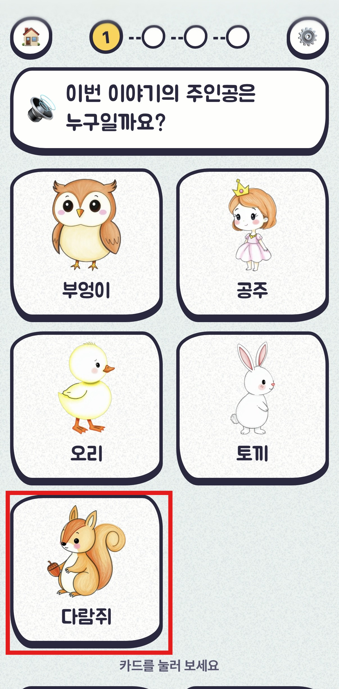
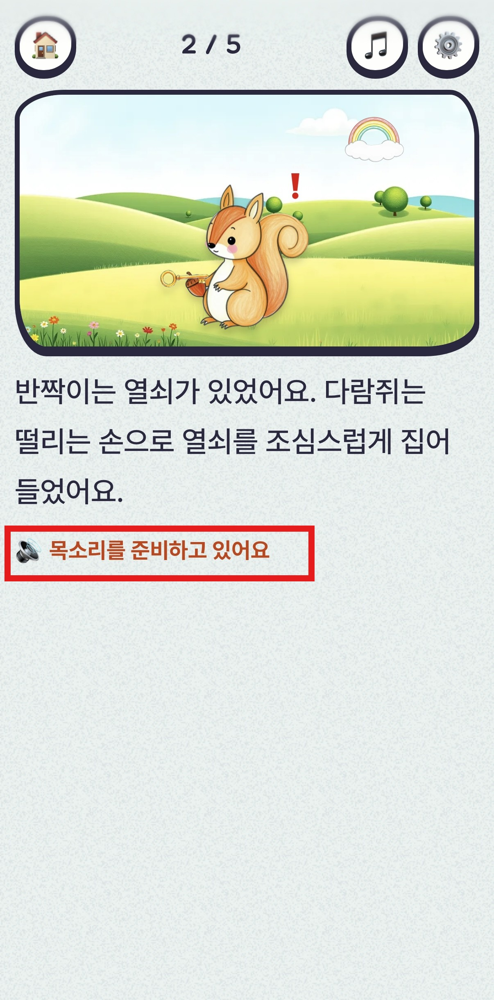
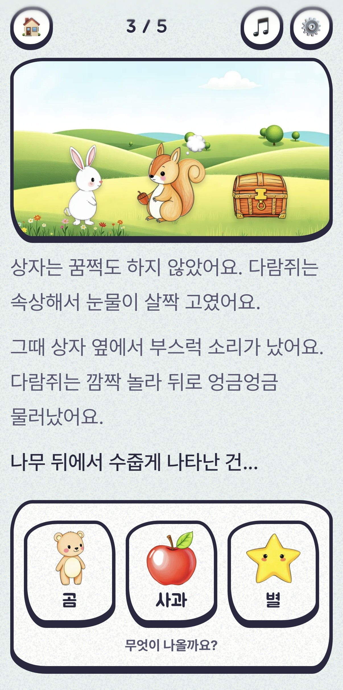
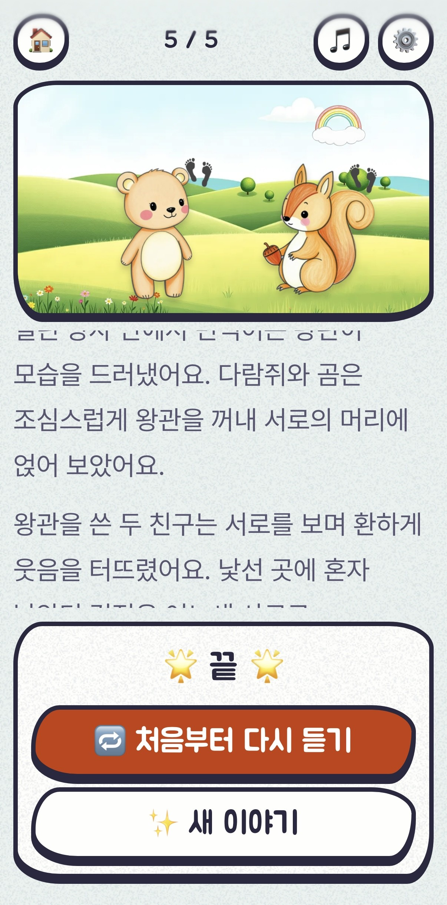
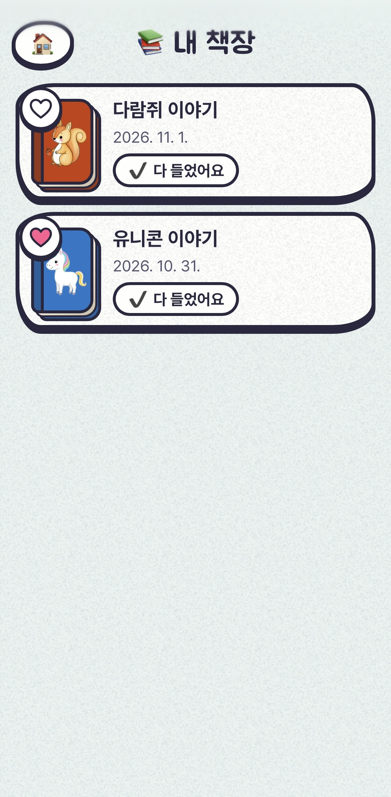

# 나만의 이야기 (My own story)

4~7세 아이가 그림 카드와 선택지를 고르면, AI 가 그에 맞춰 이야기를 이어 쓰고 읽어 주는 구연동화 웹앱(PWA)입니다.
글을 못 읽는 아이도 혼자 쓸 수 있게 질문·카드 이름을 소리로 읽어 주고, 화면은 그림책처럼 넘어갑니다.

- 배포판: 앱 https://my-own-story.pages.dev · API https://my-own-story-api.onrender.com
  - 백엔드가 무료 서버라 15분 쉬면 잠듭니다. 처음 열면 1분쯤 기다려야 할 수 있습니다.
- **운영비 0원**: 모든 외부 서비스를 무료 요금제로 씁니다. 그래서 하루에 만들고 들을 수 있는 이야기 수에 한도가 있습니다([무료 한도](#무료-한도)).

---

## 사용 흐름

```
홈 ─▶ 처음 선택 4단계 ─▶ 기다림 ─▶ 읽기 ⇄ 선택지 (4번) ─▶ 결말 ─▶ 책장에 저장
 └──────────────────────────── 내 책장 ─▶ 다시 듣기 / 이어하기
```

<table>
  <tr>
    <td align="center"></td>
    <td align="center"></td>
    <td align="center"></td>
    <td align="center"></td>
    <td align="center"></td>
  </tr>
  <tr>
    <td align="center">① 처음 선택<br>카드를 두 번 눌러 고르기</td>
    <td align="center">② 읽기<br>장면 + 글 + 이야기 음성</td>
    <td align="center">③ 선택지<br>다음에 나올 것 고르기</td>
    <td align="center">④ 결말<br>다시 듣기 · 새 이야기</td>
    <td align="center">⑤ 내 책장<br>저장된 이야기, 하트 표시</td>
  </tr>
</table>

<sub>폰 화면 캡처. PC(폭 1024px 이상)에서는 같은 화면이 펼친 그림책 배치로 나옵니다.</sub>

한 편은 **도입 → 중간 3번 → 결말**, 모두 5구간입니다. 구간마다 그림 장면 + 2~5쪽 글 + 이야기 음성이 나오고, 결말 전까지 구간 끝마다 선택지가 나옵니다.

### 1. 홈
- **✨ 새 이야기 만들기**: 처음 선택으로 갑니다. 이 터치에서 소리 재생이 허용됩니다(아이폰 등은 터치 전에 소리를 못 냄).
- **📚 내 책장**: 저장된 이야기 목록.
- **⚙️ 설정**: 아래 [설정](#설정) 참고.
- 홈이 뜨면 잠든 서버를 미리 깨웁니다.

### 2. 처음 선택 (4단계)
질문을 소리로 읽어 주고, 카드 4~5장 중 하나를 고릅니다(주인공만 5장).

| 단계 | 질문 | 예 |
|---|---|---|
| 1 | 이번 이야기의 주인공은 누구일까요? | 곰, 여우 |
| 2 | (주인공)은 한마디로 말하면... | 용감한, 수줍은 |
| 3 | 어디에서, 어떤 날 일어난 이야기일까요? | 숲, 바닷가 + 시간대 |
| 4 | (주인공)이 가지고 있던 것은? | 보물상자 |

- **카드는 두 번 눌러 고릅니다.** 처음 누르면 이름을 읽어 주고, 같은 카드를 한 번 더 누르면 고릅니다.
- 질문 칸을 누르면 질문을 다시 읽습니다. **◀ 이전**으로 앞 단계, **🔄 다시 뽑기**로 지금 단계 카드를 새로 받습니다.

### 3. 기다림
고른 카드가 책 속으로 날아가는 화면입니다. 첫 구간을 만드는 데 보통 10~30초 걸립니다.

### 4. 읽기
- 장면 그림과 글이 나오고 이야기 음성이 자동으로 재생됩니다. 쪽은 음성에 맞춰 넘어갑니다.
  - PC(폭 1024px 이상)는 펼친 그림책처럼 쪽이 넘어갑니다. 폰은 같은 디자인에 세로 배치입니다.
- 위쪽 버튼: 🏠 처음으로, ⏸️ 잠깐 멈추기, 🎵 음악 끄기, ⚙️ 설정.
- 음성이 아직 안 왔거나 실패하면 **다음 ▶** 버튼으로 직접 넘깁니다(음성이 60초 넘게 늦을 때도 나타남).
- 구간 끝에서 **선택지**가 나옵니다. 고르는 방법은 카드와 같습니다(한 번 누르면 읽기, 두 번 누르면 고르기). 고르면 장면 위에 '만들고 있어요' 덮개가 뜨고 다음 구간이 이어집니다.
- **결말** 뒤에는 ▶ 이어 듣기 / 🔁 처음부터 다시 듣기 / ✨ 새 이야기. 다시 들을 때는 ◀ 이전 / 다음 ▶ 으로 쪽을 옮길 수 있습니다.

### 5. 내 책장
- 이야기는 **이 브라우저의 저장소(IndexedDB)** 에만 저장됩니다. 서버에는 남지 않아서 기기나 브라우저를 바꾸면 책장이 비어 있습니다.
- 책을 누르면: 다 들은 이야기는 **다시 듣기**(바로 처음부터), 만드는 중인 이야기는 **이어하기**, 그리고 **지우기**(한 번 더 확인).
- 표지 왼쪽 위 하트: 좋아하는 이야기 표시.
- 음성(MP3)도 함께 저장되므로 다시 들을 때는 무료 음성 한도를 쓰지 않습니다(최근 20편까지).

### 설정
| 항목 | 내용 |
|---|---|
| 음악 크기 · 목소리 크기 | 배경 음악·이야기 음성 크기 |
| 빠르기 | 0.8~1.3배 |
| 이야기 목소리 | 무작위 / 또렷한(Kore) / 산뜻한(Aoede) / 앳된(Leda). 미리 듣기 가능. **새로 시작하는 이야기부터** 적용 |
| 안내 목소리 | 질문·카드·선택지를 읽는 목소리(여성·남성) |

### 오류 화면
| 문구 | 이유 | 할 일 |
|---|---|---|
| 이야기가 잠깐 멈췄어요 + **다시 해볼까요?** | 생성 실패·네트워크 | 다시 누르기 |
| 오늘은 이야기를 많이 들었어요. 내일 또 만나요 | 이 기기의 하루 이야기 수(3편) 초과 | 다음 날(한국 시간 자정) |
| 오늘은 이야기 친구가 쉬어요 | 서버 전체 하루 한도(30편)·같은 구간 반복 요청 초과 | 다음 날 |

---

## 로컬에서 실행하기

명령은 **Windows 명령 프롬프트(cmd)** 기준입니다. macOS·Linux 는 `copy` 를 `cp` 로 바꾸면 나머지는 같습니다.

### 0. 준비물

| 도구 | 버전 | 설치 |
|---|---|---|
| Git | 아무 버전 | https://git-scm.com |
| uv (Python 도구) | 0.5 이상 | `powershell -ExecutionPolicy ByPass -c "irm https://astral.sh/uv/install.ps1 \| iex"` — Python 3.12 는 uv 가 알아서 받습니다 |
| Node.js | 20.19 이상 (22 권장) | https://nodejs.org |
| Gemini API 키 | 무료 | [Google AI Studio](https://aistudio.google.com/apikey) → Create API key. **카드 등록 없이** 무료 한도로 씁니다 |

> 결제 정보를 등록한 Google 프로젝트의 키를 쓰면 무료 한도를 넘는 사용량이 과금될 수 있습니다. 결제가 연결되지 않은 프로젝트의 키를 쓰세요.

### 1. 받기

```bat
git clone https://github.com/stealth9195/my-own-story.git
cd my-own-story
```

### 2. 백엔드 설정 (`backend/.env`)

```bat
cd backend
copy .env.example .env
uv sync
uv run python -c "import secrets;print(secrets.token_hex(32))"
```

마지막 줄이 출력한 64자 문자열을 `STORY_SECRET` 에 넣습니다. `.env` 를 열어 **아래 두 줄만 채우면** 실행됩니다. 나머지(`PRIMARY_MODEL`, `SECONDARY_MODEL`, `PROMPT_VERSION`, 하루 한도, `CORS_ORIGINS`)는 예시 파일 값 그대로 둡니다.

```ini
GEMINI_API_KEY=AIza...                 # Google AI Studio 키 (이야기 생성 + 이야기 음성)
STORY_SECRET=3f9a...(64자)             # 구간 서명 비밀값, 32자 이상. 비면 서버가 시작하지 않음
```

선택 항목:

| 이름 | 없으면 | 설명 |
|---|---|---|
| `AZURE_SPEECH_KEY`, `AZURE_SPEECH_REGION` | 질문·카드를 브라우저 기본 음성(기계음)으로 읽음 | Azure 음성 서비스 무료(F0). 지역 예: `koreacentral` |
| `TYPECAST_API_KEY` | Gemini 음성 한도가 다 차면 글만 나옴 | 예비 이야기 음성(무료: 월 15,000자) |
| `ELEVENLABS_*` | 설정 창에 시연용 목소리가 안 나옴 | **유료 구독 크레딧**을 씀. 평소에는 비워 두기 |
| `OPENROUTER_API_KEY` | — | 모델 평가 도구(eval)에서만 씀 |

> `.env` 의 JSON 목록 값(`CORS_ORIGINS` 등)은 작은따옴표로 감쌉니다. `uv run --env-file` 이 큰따옴표를 지워서 서버가 시작하지 않은 적이 있습니다.

### 3. 백엔드 실행 (터미널 1, `backend` 폴더)

```bat
uv run --env-file .env uvicorn --factory app.main:build_app --port 8001
```

`Application startup complete.` 가 나오면 됩니다. 확인: http://localhost:8001/api/start-options 에서 카드 목록(JSON)이 보이고, http://localhost:8001/docs 에서 API 를 직접 눌러 볼 수 있습니다.

### 4. 프론트 실행 (터미널 2, `frontend` 폴더)

```bat
cd frontend
npm ci
npm run dev
```

http://localhost:5173 을 엽니다. 개발 서버가 `/api` 요청을 8001 로 넘겨 주므로 따로 주소를 설정할 필요가 없습니다(**백엔드를 먼저 켜 두어야** 카드가 나옵니다).

- 휴대폰으로 보기: 같은 와이파이에서 `npm run dev -- --host` 로 띄우고, 터미널에 나온 `Network:` 주소를 엽니다.
- PWA(설치·오프라인 캐시)까지 확인: `npm run build` 후 `npm run preview -- --port 4173`. 이 경우 화면이 `/api` 를 4173 으로 부르므로, 백엔드 `.env` 의 `CORS_ORIGINS` 에 `http://localhost:4173` 을 더하고 `frontend/.env.production.local` 에 `VITE_API_BASE=http://localhost:8001` 을 넣은 뒤 빌드합니다.

### 5. 테스트

외부 API 를 부르지 않으므로 키 없이 돌아갑니다.

```bat
:: backend 폴더
uv run pytest

:: frontend 폴더
npm test
npm run build
```

### 문제 해결

| 증상 | 원인 · 해결 |
|---|---|
| 백엔드가 `story_secret` / `primary_model` 오류로 안 켜짐 | `.env` 에 `STORY_SECRET`(32자 이상)·`PRIMARY_MODEL` 이 비었음 |
| 처음 선택에서 '다시 해볼까요?'만 나옴 | 백엔드가 꺼졌거나 8001 이 아닌 포트로 켜짐 |
| 기다림 뒤 '이야기가 잠깐 멈췄어요' | Gemini 키가 틀렸거나 분당·하루 한도 초과. 백엔드 터미널의 `segment_failed` 기록에서 원인 확인 |
| 글은 나오는데 음성이 없음 | Gemini TTS 하루 한도 소진(아래). 다음 ▶ 으로 넘기며 읽기 |
| 콘솔 한글이 깨져 보임 | Windows 콘솔(cp949) 문제. 동작에는 영향 없음 |
| `.env` 를 고쳤는데 그대로 | 백엔드를 껐다 켜기(`.env` 는 시작할 때만 읽음) |
| 화면이 예전 그대로 | 개발 서버가 파일 변경을 놓칠 때가 있음 → `npm run dev` 재시작. 설치한 PWA 는 껐다 켜기 |
| `STORY_SECRET` 을 바꾼 뒤 이어하기가 안 됨 | 정상. 예전 서명이 맞지 않아 이어 쓸 수 없음 → 새 이야기 |

---

## 무료 한도

| 무엇 | 한도 | 넘으면 |
|---|---|---|
| 이야기 생성(Gemini Flash Lite 2개) | 서버 설정: 기기당 하루 3편, 전체 30편(한국 시간 자정 초기화) | 오류 화면 '내일 또 만나요' |
| 이야기 음성(Gemini TTS) | **모델마다 하루 10회**, 분당 3회. 1편 = 5회. 태평양 시간 자정(한국 16~17시) 초기화 | 같은 목소리로 다른 Gemini TTS 모델(4개) → Typecast → 글만 |
| 안내 목소리(Azure F0) | 하루 15,000자(서버 계산) | 브라우저 음성 |

- 서버 한도 계산은 메모리에서 하므로 **서버를 다시 켜면 0부터** 셉니다. 실제 한도는 Google 이 막으므로 과금은 없고, 그 구간이 글만 나옵니다.
- 책장에서 다시 듣기는 저장된 음성을 쓰므로 한도를 쓰지 않습니다.

---

## 구조

```
my-own-story/
├─ backend/            FastAPI 서버 (Python 3.12, uv)
│  ├─ app/main.py      서비스 API (아래 표)
│  ├─ app/story/       프롬프트 조립·생성·검사·고치기 (generator, validator, tidy, hero)
│  ├─ app/llm/         OpenAI 호환 LLM 클라이언트 (Gemini 주소 사용)
│  ├─ app/tts/         Gemini·Azure·Typecast·ElevenLabs 음성
│  ├─ app/api/         서명, 하루 한도, 목소리 고르기, 기록
│  ├─ app/lab/         실험 서버·화면 (프롬프트·모델·음성 비교용)
│  ├─ eval/            모델·프롬프트 평가, TTS 비교
│  ├─ tools/           그림 변환(assets), 앱 아이콘, 목소리 미리 듣기 파일
│  └─ tests/
├─ frontend/           React 19 + Vite + TypeScript, 일반 CSS, PWA
│  ├─ src/App.tsx      화면 전환 (라우터 없이 screen 값 하나)
│  ├─ src/screens/     Home, StartPick, Waiting, Reading, Shelf, Problem
│  ├─ src/components/  Scene(장면 조립), Picture, Settings
│  ├─ src/story.ts     계산 (다음 요청, 쪽 시간, 조사 은/는)
│  ├─ src/storage.ts   책장 (IndexedDB)
│  └─ public/          그림(img/*.webp), 효과음, 배경 음악, 아이콘
├─ shared/catalog.json 주인공·성격·배경·사물·장면 목록 (백엔드·프론트 공용)
├─ prompts/v1~v9/      이야기 프롬프트 버전 (기본 v9)
├─ assets/             그림 생성 프롬프트 (원본 PNG 는 git 제외)
├─ docs/               배포 안내, 기획안·구현 계획
└─ render.yaml         Render 백엔드 설정
```

### 서비스 API

| 메서드 · 주소 | 하는 일 |
|---|---|
| `GET /api/start-options` | 처음 선택 4단계 후보 카드(무작위) |
| `POST /api/stories` | 고른 카드 4장으로 이야기 시작 → 첫 구간(도입) |
| `POST /api/stories/next` | 지난 구간 전체 + 고른 선택지 → 다음 구간 |
| `POST /api/tts` | 구간 하나의 이야기 음성(MP3) |
| `POST /api/speak` | 질문·카드·선택지 읽기(Azure, 200자 이하) |
| `GET /api/voices` | 시연용 목소리 목록(없으면 빈 목록) |
| `POST /api/events` | 사용 기록(서버 로그에만 남음) |

**서버는 이야기를 저장하지 않습니다.** 구간마다 HMAC 서명(비밀값으로 만든 위조 방지 도장)을 붙여 돌려주고, 화면은 다음 요청 때 지난 구간을 서명과 함께 다시 보냅니다. 글을 고쳐 보내면 `400 bad_signature` 로 거절되므로, 사용자가 프롬프트에 임의의 글을 넣을 수 없습니다.

### 이야기 한 구간이 만들어지는 과정

1. `prompts/v9` 프롬프트에 고른 카드·지난 구간·고른 선택지·그림 목록을 넣습니다.
2. Gemini 3.5 Flash Lite 와 3.1 Flash Lite 를 **동시에** 불러, 먼저 검사를 통과한 글을 씁니다(구간당 10~25초 → 대기 단축).
3. 검사기(`story/validator.py`): JSON 형식, 쪽 수·쪽당 글자 수, 목록 밖 그림 ID, 금지어, 끊긴 문장 등. 실패하면 다시 요청합니다.
4. 더듬기 오타(`꼬 꼭`)를 고치고, 결말 장면에 주인공이 빠졌으면 넣은 뒤 서명합니다.

---

## 개발 도구

### 서버 없이 화면 확인 (`npm run dev` 에서만)

| 주소 | 화면 |
|---|---|
| http://localhost:5173/?demo | 장면·사물 위치 비교, 링크 모음 |
| `?demo=reading` · `reading-phrase` · `reading-turn` | 읽기 화면 · 문장 선택지 · 책장 넘김(3쪽) |
| `?demo=waiting` | 기다림 화면 |
| `?demo=problem` · `problem-limit` | 오류 화면 |

`?demo=reading` 에서 선택지를 고르면 가짜 이야기(1970년 날짜)가 책장에 저장됩니다. 이어하기를 누르면 서명이 가짜라 오류가 나는 게 정상이니 책장에서 지우세요.

### 실험 서버 (프롬프트·모델·음성 비교)

```bat
:: backend 폴더 → http://localhost:8000
uv run --env-file .env uvicorn app.lab.server:app --port 8000
```

### 모델 평가

```bat
:: 생성 → 익명 내보내기 → (사람·챗봇이 scores/*.csv 에 점수) → 요약
uv run --env-file .env python -m eval.run_generate --out eval/results/<이름> --version v9
uv run python -m eval.export eval/results/<이름>
uv run python -m eval.summarize eval/results/<이름>

:: TTS 비교
uv run --env-file .env python -m eval.tts_check
```

- `run_generate` 는 `eval/models.json` 이 필요합니다(`models.example.json` 을 복사). `--version` 을 빼면 v1 이 쓰이니 꼭 지정합니다.

### 그림·아이콘 만들기

```bat
:: assets/raw/{id}.png → frontend/public/img/*.webp (배경 제거), 앱 아이콘
uv run --group assets python -m tools.assets
uv run --group assets python -m tools.icons
```

---

## 배포

프론트 **Cloudflare Pages**, 백엔드 **Render 무료**(둘 다 카드 등록 없음). master 에 push 하면 둘 다 다시 배포됩니다. 순서·환경 변수·주의점은 [`docs/deploy.md`](docs/deploy.md) 에 있습니다.

---

## 설계 판단

- **운영비 0원**: Cloud Run 은 카드 등록·과금 위험 때문에 쓰지 않고 Render 무료를 씁니다. LLM·TTS 는 모두 Google 무료 한도 안에서 씁니다.
- **DB 없음**: 빠른 완성을 위해 서버는 저장하지 않고(서명으로 위조 방지), 책장은 기기의 IndexedDB 에 둡니다.
- **그림 고르기**: 임베딩 검색 대신 프롬프트에 그림 목록을 넣고 ID 만 고르게 합니다. 목록 밖 ID 는 검사기가 거절합니다.
- **음성이 막힐 때**: 같은 목소리 이름의 다른 Gemini TTS 모델까지만 대신 씁니다. 다른 목소리로 바꾸면 이야기 중간에 목소리가 확 달라지기 때문입니다.
- **글 못 읽는 아이**: 두 번 눌러 고르기(첫 터치는 이름 읽기), 큰 버튼, 글보다 그림.

자세한 배경: 기획안 [`docs/superpowers/specs/`](docs/superpowers/specs/), 구현 계획 [`docs/superpowers/plans/`](docs/superpowers/plans/).

## 에셋 출처

- 그림: ComfyUI + FLUX.1 schnell 로 직접 생성 ([`assets/image-prompts.html`](assets/image-prompts.html))
- 배경 음악: ElevenLabs 로 직접 제작
- 효과음: Pixabay — [`frontend/public/sound/SOURCES.md`](frontend/public/sound/SOURCES.md)
- 글꼴: Jua(Google Fonts), Pretendard(jsDelivr) — 인터넷에서 불러오므로 오프라인이면 기본 글꼴로 보입니다
